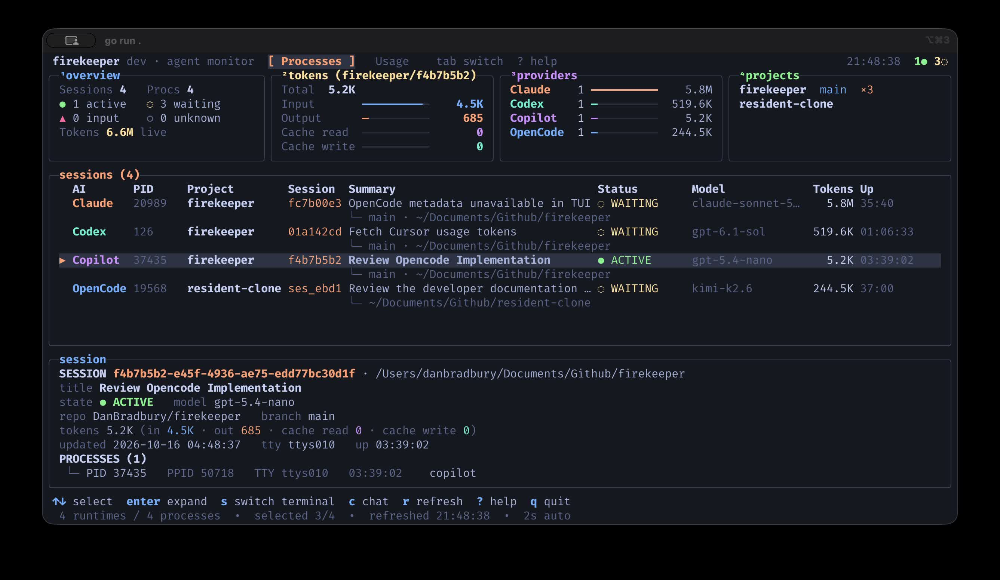

# Firekeeper

**One terminal dashboard for all your coding agents.**

[](https://github.com/DanBradbury/firekeeper/actions/workflows/ci.yml)
[](LICENSE)

See which agents are working or need attention, read their latest replies,
and check token usage without hunting through terminal tabs. Firekeeper
discovers **Claude Code, Codex, GitHub Copilot CLI, Kimi Code, OpenCode,
Gemini CLI, and Cursor CLI** running on your machine.

**Free and open source. No Firekeeper account, server, or agent wrappers
required.** Launch your agents as usual, then open `firekeeper` beside them.
The terminal dashboard reads local session data without uploading it;
[usage lookups and update checks](https://firekeeper.ai/docs/usage/#network)
can contact the network.

[Install](#install) · [First run](#first-run) ·
[Usage guides](https://firekeeper.ai/docs/) ·
[Troubleshooting](https://firekeeper.ai/docs/troubleshooting/)

## Install

Choose **one** method. All three install a prebuilt binary; no Go toolchain
is needed.

**macOS — Homebrew**

```sh
brew install DanBradbury/tap/firekeeper
```

**macOS or Linux — install script**

```sh
curl -fsSL https://raw.githubusercontent.com/DanBradbury/firekeeper/main/install.sh | sh
```

Installs to `~/.local/bin` without `sudo`. Follow the installer's `PATH`
hint if that directory is not on your path.

**Windows — PowerShell 5.1 or 7**

```powershell
irm https://raw.githubusercontent.com/DanBradbury/firekeeper/main/install.ps1 | iex
```

Installs to `%LOCALAPPDATA%\Programs\firekeeper` and adds it to your user
`PATH`; no administrator rights are needed.

The script commands download and execute code. For manual downloads,
checksum verification, version pinning, source builds, or uninstalling, see
[Install and uninstall](docs/install.md).

macOS (Apple Silicon and Intel) is the main target. Windows 10 1809+ and 11
(amd64 and arm64) are supported with [platform limitations](docs/reference.md#windows).
Linux (amd64 and arm64) is best effort.

## First run

1. Start a supported agent in your project using its usual command, or leave
   an existing session running. Firekeeper does not install or launch agents.
2. Open another terminal window, tab, or pane on the same machine, as the same
   user, and run `firekeeper` from any directory.
3. The **Processes** view should show your running agents within a couple of
   seconds. Select a row to see its project, state, model, and available tokens.

| Key | What to do |
| --- | --- |
| Up / Down | Select an agent runtime |
| `c`, then Esc | Read its conversation, then return |
| `s` | Jump to its terminal on macOS or Windows |
| Tab | Switch between Processes, Overview, and Usage |
| `?` | Show all keyboard shortcuts |
| `q` | Quit from a main view; your agents keep running |

Terminal switching supports Ghostty 1.3+, Terminal.app, and iTerm2 on macOS.
On Windows it raises the window, not the tab; Linux has no terminal switching.
An empty list usually means no supported agent is running where Firekeeper
can see it. See the [missing-session checklist](https://firekeeper.ai/docs/troubleshooting/#missing-session).
You do **not** need `login`, `serve`, or `daemon install` to use this dashboard.



## What you get

- **Follow work across projects.** Processes groups each agent runtime with
  its child processes and shows available state, model, directory, Git branch,
  and tokens. Check which session needs attention without visiting every tab.
- **Understand usage.** Overview summarizes local tokens and available
  provider limits; Usage breaks history down by model and lets you open past
  conversations. See [what each provider reports](https://firekeeper.ai/docs/usage/).
- **Read without interrupting.** The chat view follows new prompts and replies
  live, read-only. Return to the agent's own terminal to reply or approve work.
- **Take your history with you.** `firekeeper snapshot --json` prints discovered
  sessions for scripts. Transcript exports and server reporting are separate,
  optional commands in the [reference](docs/reference.md#reporting).

Usage history is available for Codex, Copilot CLI, Claude Code, and Kimi Code.
Local token totals can be incomplete and are not an account-wide bill.

## Supported agents

| Agent | Live dashboard | Optional transcript upload |
| --- | --- | --- |
| Claude Code | Yes | Yes |
| Codex | Yes | Yes |
| GitHub Copilot CLI | Yes | Yes |
| Kimi Code | Yes | Yes |
| OpenCode | Yes | Yes |
| Gemini CLI | Yes | Yes |
| Cursor CLI | Yes | Yes |

A Claude Code session that has subagents warns that its token total is likely
low: background summary calls are not written to the transcript. The warning
has no count. See the
[reference](docs/reference.md#claude-code-subagent-undercount).

States describe the latest event Firekeeper can see, not ground truth, and
agent CLIs can change their on-disk formats between releases. The
[reference](docs/reference.md#supported-providers) lists exactly what is read
for each one, and what each version needs.

## Private by default

- Plain `firekeeper` uploads no session data and starts no daemon. Provider
  usage lookups and release checks can contact the network; the
  [usage guide](https://firekeeper.ai/docs/usage/#network) names them.
- Uploading is a separate set of commands that you run on purpose, and it is
  opt-in per agent. `firekeeper report --dry-run` shows what would be sent
  without opening a connection.
- Every event is redacted on your machine before it leaves. Redaction is best
  effort, not a guarantee. [What is uploaded and what is not
  caught](docs/reference.md#what-is-uploaded-and-what-is-not-caught) says
  what it misses.
- A repository containing a `.firekeeper-ignore` file is never read.
- `firekeeper telemetry enable` opts this machine into a loopback listener for Claude Code's own usage export. It does not start with the dashboard, it binds to 127.0.0.1 only, and it does not upload. The [research note](docs/research/otel-telemetry.md) has the details.
- Whoever runs the server you upload to can read what you send. With a server
  you run yourself, that is you.

The code that reads your sessions is in this repository, so you can check all
of this. [PRIVACY.md](PRIVACY.md) describes what the client reads, writes,
and sends.

## Send sessions to a server (optional)

Already using the local dashboard? Reporting is a separate workflow for
sending session metadata and full transcripts to a server you choose.
Start with a local preview; this command uploads nothing:

```sh
firekeeper backfill --all --dry-run
```

Before enabling uploads, read the [reporting guide](docs/reference.md#reporting)
for linking a machine, choosing providers, importing history, and installing
the optional background reporter. Redaction is best effort, and the server
operator can read what you send.

### The dashboard server

`firekeeper-server` is a separate commercial product from Lucky Daisy LLC
for browsing, searching, and charting reported sessions in a browser. It is
not part of this repository or required by the terminal dashboard.
**It is free to run for yourself on this machine** without a license key;
team, remote, or hosted use requires a license.

Run `firekeeper serve` to launch it. If the server is missing, release builds
offer to download it and ask for confirmation first. See
[server installation, updates, and license configuration](docs/reference.md#installing-the-server-from-serve)
or [server plans](https://firekeeper.ai/#pricing).

The protocol is open. The reporter speaks the HTTP API in
[docs/api.md](docs/api.md) and the event format in
[docs/event.schema.json](docs/event.schema.json), so other tools can accept
sessions too. The Go packages in [pkg/](pkg/README.md) (`event`, `redact`, and
`contract`, which carries the schema and example API bodies with validators)
are the stable, importable pieces of that contract.

## Documentation

- [Usage guides](https://firekeeper.ai/docs/): quick start, everyday workflows,
  usage data, keyboard shortcuts, and troubleshooting
- [Install and uninstall](docs/install.md)
- [Reference](docs/reference.md): terminal dashboard, reporting, the daemon,
  and configuration
- [HTTP API](docs/api.md) and [event schema](docs/event.schema.json)
- [PRIVACY.md](PRIVACY.md)

## Status

Firekeeper is an early-stage project. macOS is the main target, Linux is best
effort, and Windows is supported but has had the least real-world use. Expect adapters and metadata handling
to evolve as the agent CLIs change. Bug reports and requests for more agents
are welcome as [issues](https://github.com/DanBradbury/firekeeper/issues).

## License

Apache License 2.0. See [LICENSE](LICENSE), [NOTICE](NOTICE), and
[THIRD_PARTY_NOTICES.md](THIRD_PARTY_NOTICES.md).
